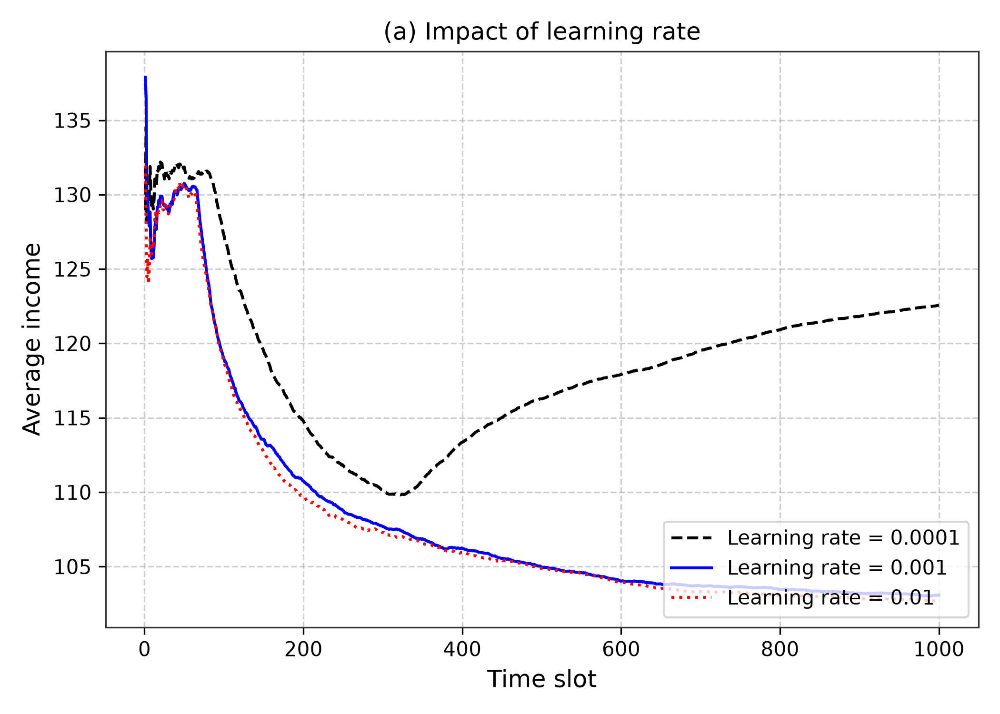
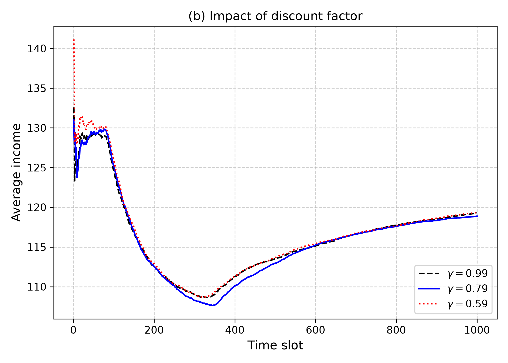
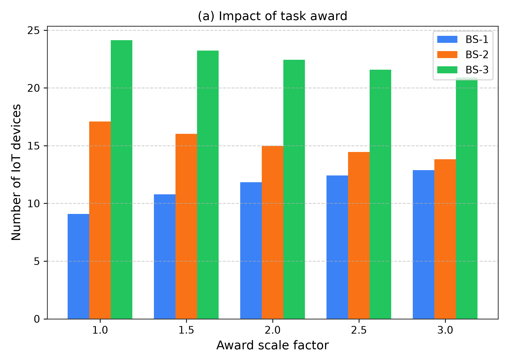
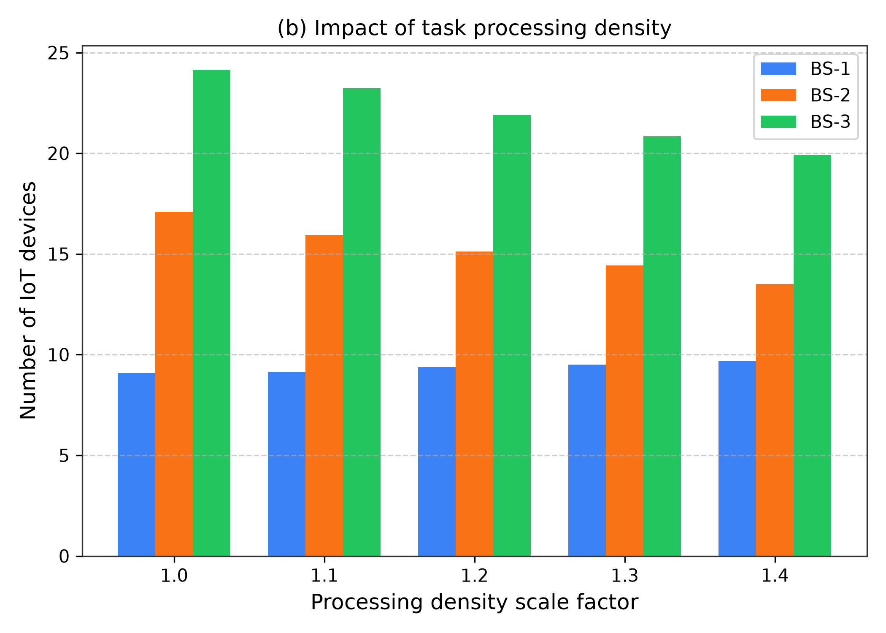
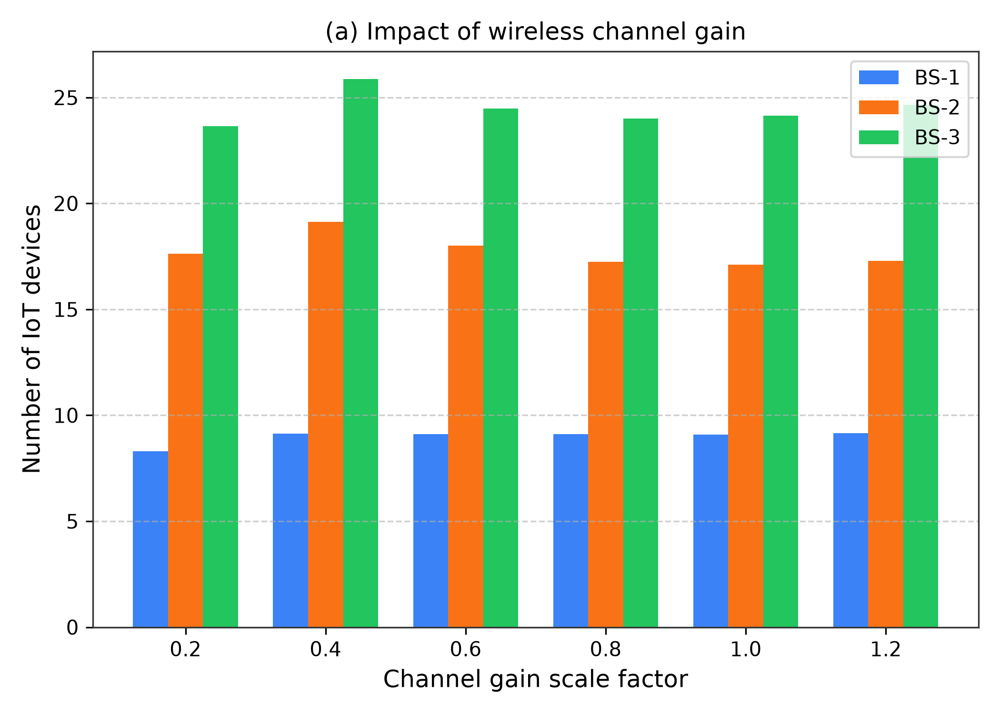
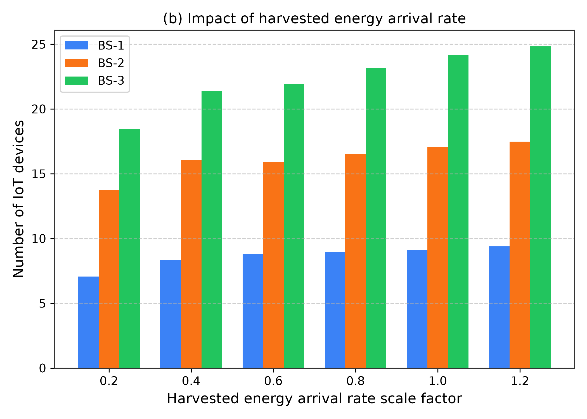
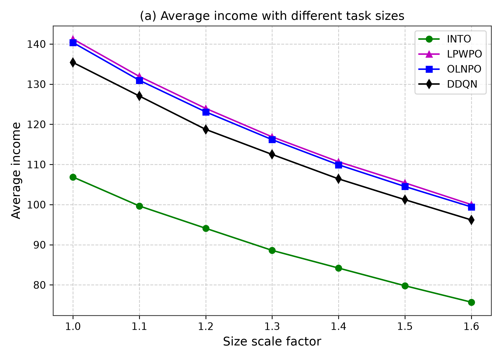
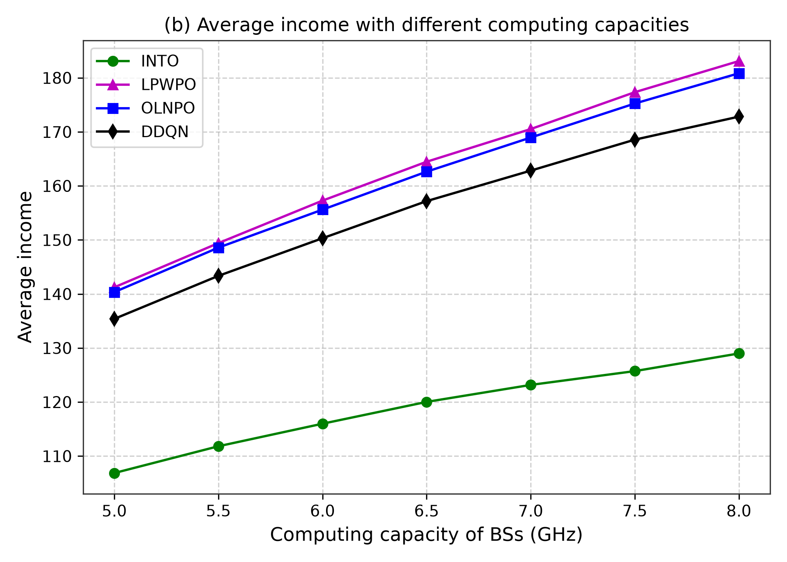
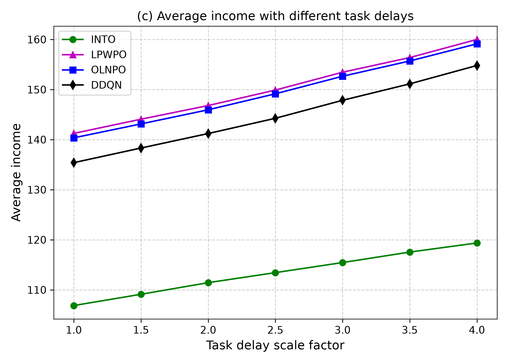
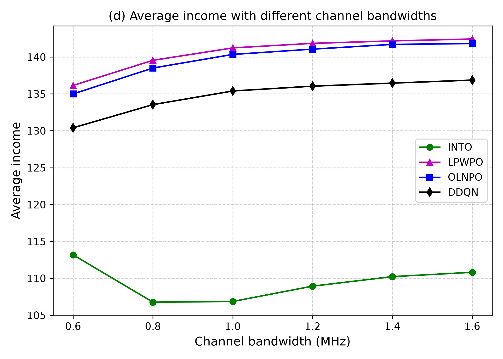

# Digital Twin-Driven Intelligent Task Offloading for Collaborative Mobile Edge Computing

[](https://www.python.org/downloads/)
[](https://pytorch.org/)
[](https://github.com/EdgeSimPy/EdgeSimPy)

A high-fidelity simulation implementation of the **INTO (Intelligent Task Offloading)** algorithm and collaborative Mobile Edge Computing (MEC) framework described in the research paper:

> **Digital Twin-Driven Intelligent Task Offloading for Collaborative Mobile Edge Computing**  
> *Yongchao Zhang, Jia Hu, and Geyong Min*  
> *IEEE Journal on Selected Areas in Communications (JSAC), Vol. 41, No. 10, October 2023*  
> [DOI: 10.1109/JSAC.2023.3310058](https://doi.org/10.1109/JSAC.2023.3310058)

---

## 🌐 Overview & Architecture

Collaborative Mobile Edge Computing (MEC) enables distributed Base Stations (BSs) to share computation workloads via peer offloading. However, stochastic wireless channels, battery limitations of IoT devices, and heterogeneous task demands make joint offloading and resource allocation challenging.

This repository provides:
1. **Digital Twin (DT) Virtual Mirror:** Models 3 Base Stations ($U_1=30, U_2=55, U_3=80$, total 165 IoT devices), battery energy buffers, intra-cell interference, and 100 Mbps optical backhaul links.
2. **Fast Action Refinement (Algorithm 1):** Directly maps continuous DRL policy outputs into valid discrete offloading decisions that guarantee battery feasibility (Eq. 5), deadline fulfillment, and MEC CPU capacity constraints (Eq. 10).
3. **DRL-Based INTO Scheme (Algorithm 2):** Deep Deterministic Policy Gradient (DDPG) with target actor/critic networks and experience replay optimizing cumulative system income.
4. **EdgeSimPy Integration:** Built on top of the EdgeSimPy MEC simulation framework.

---

## 🔬 Baseline Algorithms

In addition to the proposed **INTO** scheme, this repository evaluates all three state-of-the-art comparison algorithms mentioned in the paper:

- **OLNPO (*Only Local No Peer Offloading*):** Tasks generated in BS $i$ can only be processed by BS $i$. Peer offloading to other BSs is strictly prohibited ($y^{i'}_{ij} = 0, \forall i' \neq i$).
- **LPWPO (*Local Priority With Peer Offloading*):** Each base station gives strict priority to its locally covered IoT devices. Only surplus CPU capacity remaining after local execution is made available to assist peer BSs.
- **DDQN (*Double Deep Q-Network*):** A value-based deep reinforcement learning benchmark using a two-layer deep Q-network architecture (1000 and 600 neurons).

---

## 📂 Project Structure

```text
├── .gitignore                           # Standard git ignore (excludes .venv, large .pt weights, caches)
├── README.md                            # Comprehensive project overview and documentation
├── requirements.txt                     # Pinned Python dependencies
├── run_experiments.py                   # Root execution script for reproducing simulations
├── outputs/                             # Simulation output artifacts
│   ├── checkpoints/                     # Model weights (.pt files excluded from git)
│   ├── plots/                           # Generated publication figures (.png)
│   └── results/                         # Raw simulation metrics (.csv)
└── mec_into/                            # Core Python package
    ├── main.py                          # CLI orchestrator
    ├── config/
    │   └── experiment_config.yaml       # Paper system parameters and DRL hyperparameters
    └── src/                             # Source modules
        ├── action_refinement.py         # Algorithm 1: Fast Action Refinement
        ├── digital_twin.py              # Digital Twin state mirror & SINR rate models
        ├── environment.py               # EdgeSimPy collaborative MEC environment
        ├── evaluation.py                # Evaluation suites for Figures 3, 4, 5, and 6
        ├── into_agent.py                # Algorithm 2: INTO DDPG agent
        ├── models.py                    # Actor, Critic, and DDQN neural network architectures
        ├── task_generator.py            # Runtime stochastic task workload generation
        ├── training.py                  # DRL training pipelines
        └── baselines/                   # Comparison algorithms
            ├── ddqn.py                  # Double Deep Q-Network baseline
            ├── lpwpo.py                 # Local Priority With Peer Offloading baseline
            └── olnpo.py                 # Only Local No Peer Offloading baseline
```

---

## ⚙️ Installation & Setup

### 1. Clone the Repository
```bash
git clone https://github.com/hrishinandan-n/dt-driven-collaborative-mec.git
cd dt-driven-collaborative-mec
```

### 2. Create and Activate Virtual Environment
```bash
python3 -m venv .venv
source .venv/bin/activate
```

### 3. Install Dependencies
```bash
pip install -r requirements.txt
```

---

## 🚀 Reproducibility & Execution Commands

### Run Complete End-to-End Suite
To train the agents and reproduce all figures (Figures 3, 4, 5, 6) in one command:
```bash
python run_experiments.py --slots 1000 --eval_slots 50
```

### Modular CLI Execution
You can also run specific experimental phases independently:

```bash
# 1. Train only INTO agent
python -m mec_into.main --mode train_into --slots 1000

# 2. Train only DDQN baseline
python -m mec_into.main --mode train_ddqn --slots 1000

# 3. Run Parameter Analysis (Figures 3, 4, and 5)
python -m mec_into.main --mode param_analysis

# 4. Run Baseline Comparisons (Figure 6)
python -m mec_into.main --mode baseline_compare
```

---

## 📊 Experimental Results

All figures are reproduced using simulation runs and saved in `outputs/plots/`. Raw numerical values are preserved in `outputs/results/`.

### Figure 3: Hyperparameter Analysis
| Figure 3(a): Impact of Learning Rate | Figure 3(b): Impact of Discount Factor |
| :---: | :---: |
|  |  |

### Figure 4: Workload Sensitivity
| Figure 4(a): Impact of Task Award | Figure 4(b): Impact of Processing Density |
| :---: | :---: |
|  |  |

### Figure 5: Physical Environment Impact
| Figure 5(a): Impact of Wireless Channel Gain | Figure 5(b): Impact of Harvested Energy Arrival Rate |
| :---: | :---: |
|  |  |

### Figure 6: Baseline Comparisons
Comprehensive 4-way comparison: **INTO vs. OLNPO vs. LPWPO vs. DDQN**

| (a) Task Data Size Scale ($\chi = 1.0 \dots 1.6$) | (b) MEC Computing Capacity ($F_i = 5 \dots 8\text{ GHz}$) |
| :---: | :---: |
|  |  |
| **(c) Delay Tolerance Scale ($\psi = 1 \dots 4$)** | **(d) Channel Bandwidth ($B = 0.6 \dots 1.6\text{ MHz}$)** |
|  |  |

---
